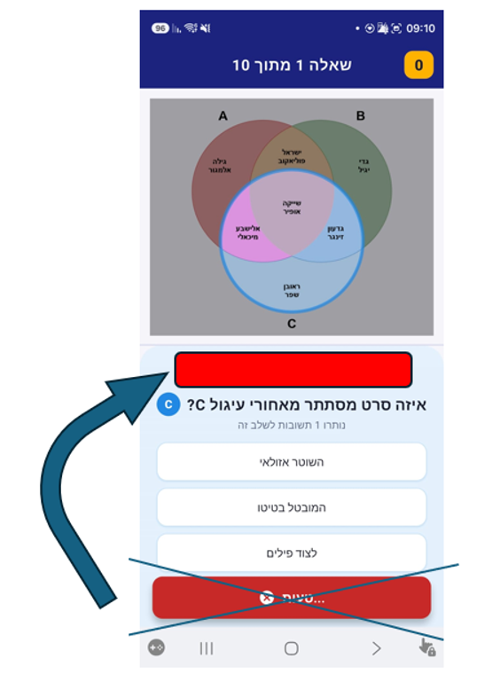
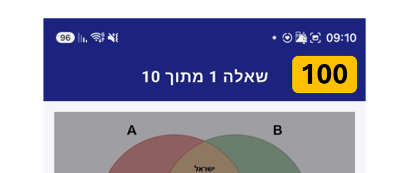
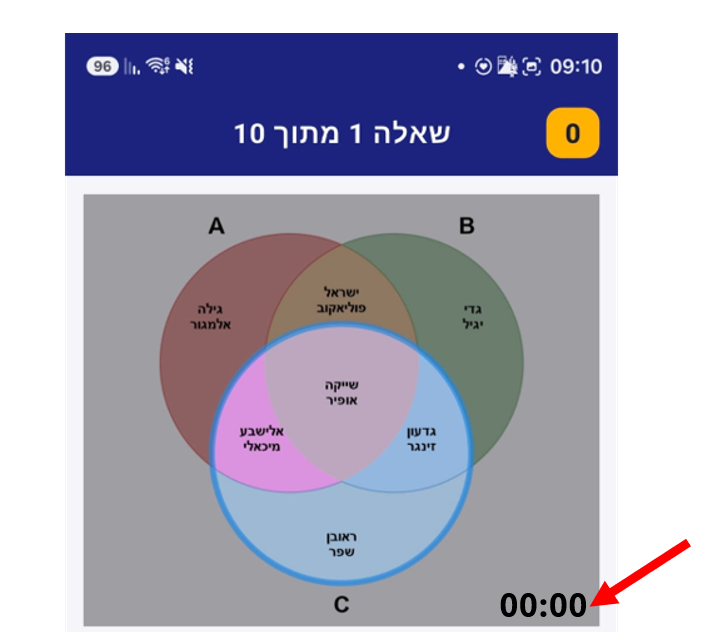
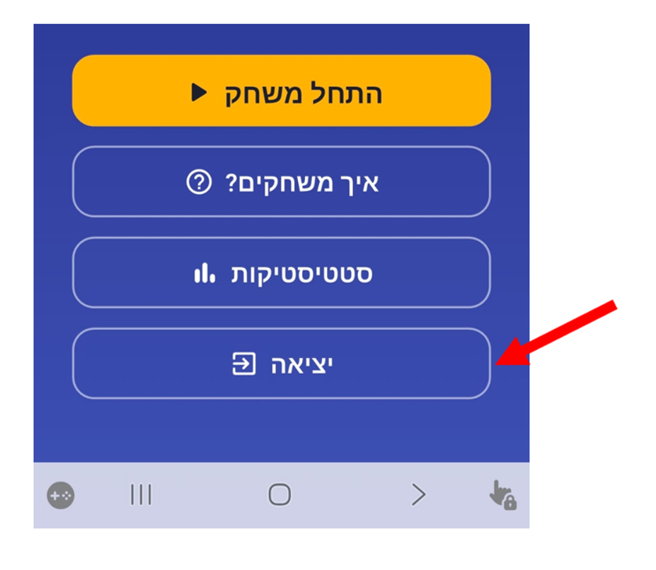
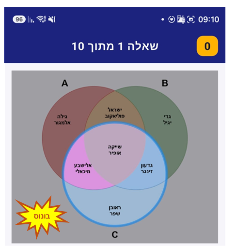
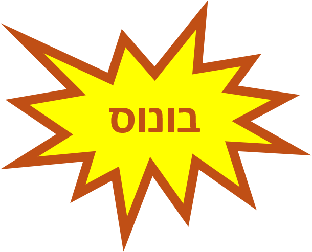
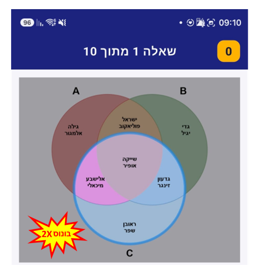
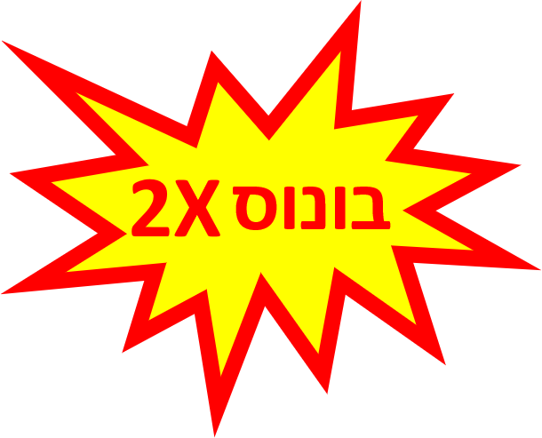

fixes to impliment after 12 tester are opted in

1. increase actor name font size - this should be done in the movenn project
2. sounds of right and wrong answer are the same, we need seaparte sound for each
3. move the corrent/wrong answer text the upper part of the answers display as in image-4
4. increase the font of the score display so it will be more visable as image-5
5. add a quesion timer in the bottom right of the question display as in image-6. time is reset for each question
6. botton "יציאה" (image-7.png) doesn't work. clicking it should close the app
7. if getting bonusTimeTier2 a mark will appear for 0.5s in the bottom left corner of the question display (as in image-8). image of the tier2 bonus mark itself is in image-9. appirance of the mark will accompanied with a short bell sound 
8. if getting bonusTimeTier1 a mark will appear for 0.5s in the bottom left corner of the question display (as in image-10). image of the tier1 bonus mark itself is in image-11. appirance of the mark will accompanied with a short bell sound (can be the same sound as tier2 bonus sound)

