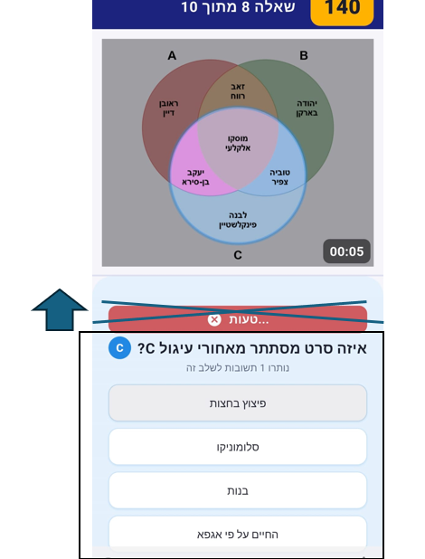
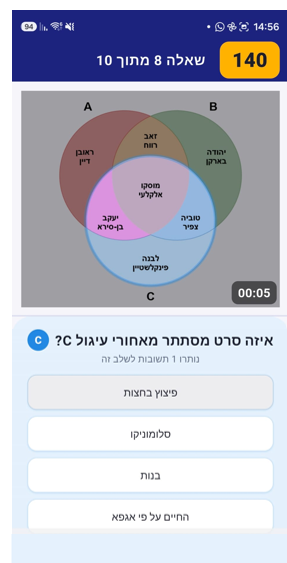
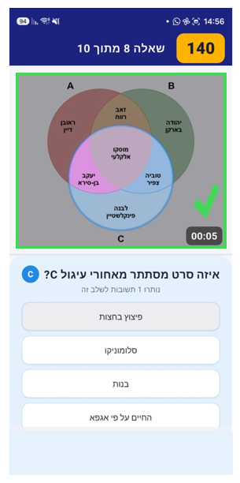
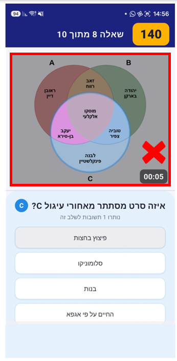

fixes to impliment for 1.0.2

1. remove the correct/wrong answer text, and move the answers upper in the answer display (as in image-3), it should be upper like in image-12
2. for a correct answer, use a green "v" sign that will appear above the question timer and a green frame around the question display (as in image-13), the green itself "v" is in image-14
3. for a wrong answer, use a red "x" sign that will appear above the question timer and a red frame around the question display (as in image-15), the red "x" itself is in image-16
4. regarding part 2 and 3 - make sure the green/red frame doesn't overlap with the question timer or the bonus mark. you can move question timer and/or the bonus mark a few pixels up if necessary .
5. the new correct right/wrong marks (the "v"/"x" and the frame) should appear also for the third circle-movie in each question (the correct/wrong answer text appear only for the first and second circle-movie and not for the third - that is a bug)

