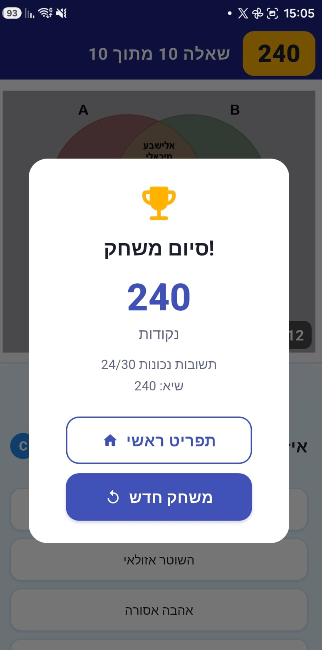
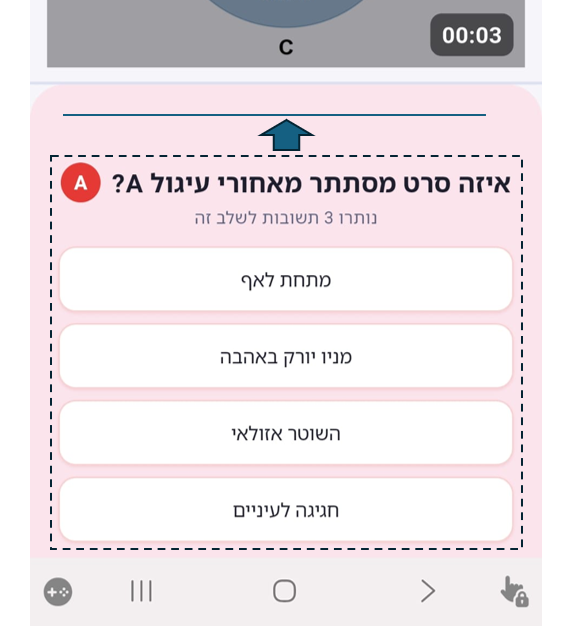
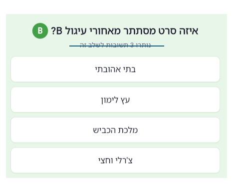

fixes to impliment for 1.0.3

1. the entire answers text in a display should move a bit higher
2. in the end game screen, the "!" is right to the "סיום משחק" (see image-17) it should be on the left
3. delete the "נותרו x תשובות לשלב זה" text and move the איזה סרט מסתתר.." a bit lower, to avoid the a unneccessary gap (as in image-19)

---

## Release Notes – v1.0.3

### Bug Fixes
1. **Answer panel positioned higher** – Reduced the answer section flex ratio (from 5 to 4 on phones) and decreased vertical padding so the question text and answer buttons sit higher on screen, improving visibility.
2. **End-game dialog exclamation mark placement** – Fixed RTL text direction issue: changed `'!סיום משחק'` to `'סיום משחק!'` so the `!` correctly appears on the left side of the Hebrew text.
3. **Removed "נותרו x תשובות לשלב זה" text** – Removed the remaining-answers counter from the answer panel and added spacing below the question row, eliminating the unnecessary gap between the question and the answer buttons.